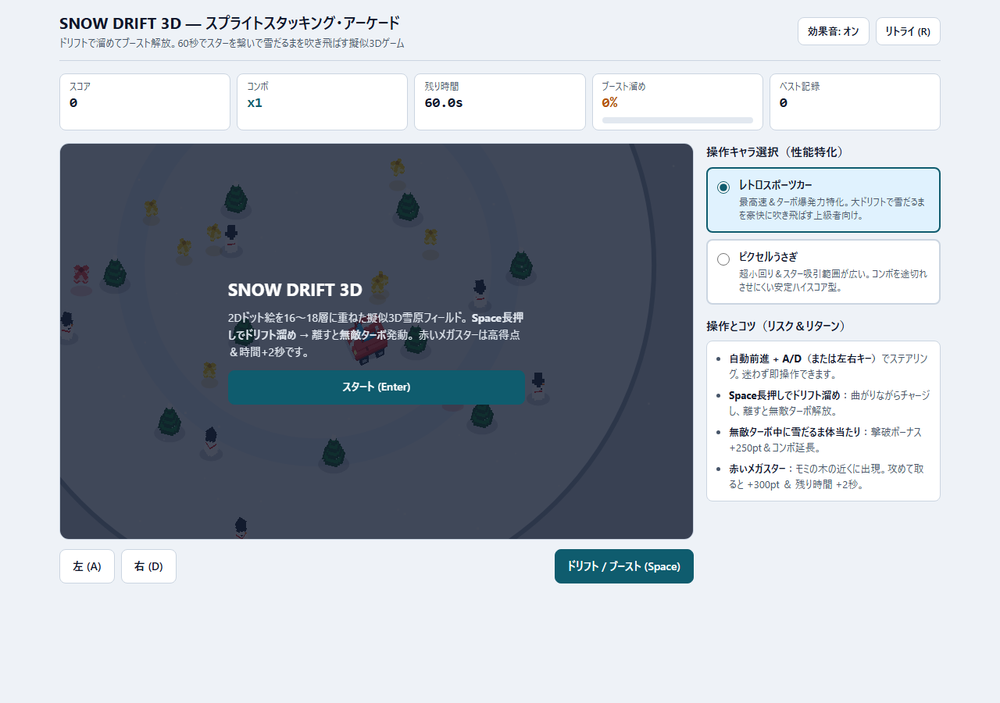

# SNOW DRIFT 3D

2Dドット絵を16〜18層重ねて疑似3D描画する、HTML5 Canvas 2D製スプライトスタッキング・アーケードゲームです。外部ライブラリ不使用・単一HTMLファイルで60fps動作します。

**[Play Now (GitHub Pages)](https://youki-dmp.github.io/snow-drift-3d/)** ｜ **[制作背景・使用ツール・設計思想（MAKING_OF.md）](./MAKING_OF.md)**

## 遊び方 / How to Play

- **ステアリング**：自動前進 ＋ `A / D` または `← / →`（スマホ・マウス用ボタン対応）
- **ドリフト＆無敵ターボ**：`Space` 長押しでドリフト溜め → 離すと無敵ターボ発動
  - ターボ中に雪だるまへ体当たりすると撃破ボーナス（`+250pt` ＆ コンボ延長）
- **ハイリスク・ハイリターン**：モミの木の近くに出現する赤いメガスターは `+300pt` ＆ 残り時間 `+2秒`
- **即スタート / リトライ**：`Enter` で開始、`R` でリトライ（ベスト記録は `localStorage` に自動保存）

## 操作キャラ（性能特化2種）

1. **レトロスポーツカー**：最高速＆ターボ爆発力特化。大ドリフトで雪だるまを吹き飛ばす上級者向け。
2. **ピクセルうさぎ**：超小回り＆スター吸引範囲が広く、コンボを繋ぎやすい安定ハイスコア型。

## 技術仕様

- **描画**：HTML5 Canvas 2D スプライトスタッキング（`imageSmoothingEnabled = false`、深度ソート、ヒットストップ、画面微震、先読みカメラ）
- **サウンド**：Web Audio API によるリアルタイム合成レトロ効果音（ミュート切替対応）
- **依存関係**：なし（単一 `index.html` のみ）

## License

MIT License
